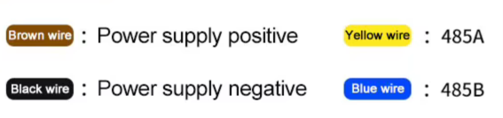

# Informe de sensores Modbus

Datos de operación de cada sensor verificado: comunicación por defecto, cómo cambiar la ID y
qué registros tiene.

| Sensor | Marca | Coincide con el datasheet | Estado |
|---|---|---|---|
| [RK330-01](#rk330-01--temperatura-y-humedad) | Rika | Sí, en lo comprado (T y H) | Verificado 2026-11-10 |
| [RK300-08](#rk300-08--multigás) | Rika | **No**: mapa distinto en los 3 documentos | Verificado 2026-11-09, con reclamo pendiente |
| [RK300-02](#rk300-02--polvo) | Rika | Sí, con el orden del ejemplo 7.4; los ejemplos 7.1–7.3 están mal | Verificado 2026-11-10 |
| [RK200-02B](#rk200-02b--radiación) | Rika | Sí, en la medición; el cambio de ID no necesita reinicio aunque el datasheet lo pida | Verificado 2026-11-10 |
| [RS-PM-N01-2 (-T)](#renke-rs-pm-n01-2--polvo) | Renke | Sí, en la medición; el cambio de ID (reg 2000) no está en el manual pero funciona | Verificado 2026-11-10 |
| [RS-GH-N01-AL-T](#renke-rs-gh-n01-al--radiación-par) | Renke | Sí, en la medición y el cambio de ID | Verificado 2026-11-11 |
| [RS-PM-N01-BYH-T](#renke-rs-pm-n01-byh--polvo-caja-de-persianas) | Renke | Sí en PM2.5 y PM10. **Sin temperatura ni humedad**, que se pidieron en la compra. El PM1.0 del manual es una copia del PM2.5. | Verificado 2026-11-11, con reclamo pendiente |
| [RS-CO2-N01-BYH-T](#renke-rs-co2-n01-byh--co2-caja-de-persianas) | Renke | Sí en CO2 y en el cambio de ID. **Sin temperatura ni humedad**, que se pidieron en la compra. | Verificado 2026-11-11, con reclamo pendiente |

## Cómo leer las tablas

**Registros**

- **Direcciones:** base 0, en decimal y en hex. Por ejemplo, `4 (0x0004)` es el registro 40005
  en notación PLC.
- **Tipos:**
  - **u16:** entero sin signo de 16 bits (0..65535).
  - **s16:** entero con signo. Si el crudo es ≥ 32768, el valor es `crudo − 65536`.
- **Conversión:** `valor = crudo × multiplicador`. Ningún sensor usa offset.
- **Escritura:** todas las escrituras (ID y baudrate) usan la función 06 (escribir un registro).

**Columna "Origen"**

- **Confirmado:** se provocó un cambio (aliento, humo, luz) y el registro respondió.
- **Datasheet:** lo dice el documento y el valor es plausible.
- **Deducido:** el documento no lo dice; se dedujo de los valores.
- **"No probado":** dato del datasheet que no se verificó en la unidad.

**Cableado:** el de los Renke no es intuitivo, porque el amarillo o el verde es el 485-A, no la
alimentación. Revisar el de cada modelo en su sección.

---

## RK330-01 — Temperatura y humedad

| Parámetro | Valor |
|---|---|
| ID por defecto | 1 |
| Serie | 9600 baud, 8N1 |
| Lectura | Función 03 (la 04 no responde) |
| Máximo por lectura | Hasta el registro 32 |

**Cambio de ID (datasheet, no probado):**

- **Cómo:** función 06 en el **registro 0** con la ID nueva.
- **Efecto:** rige después de reiniciar el sensor.
- **Respuesta:** no es el eco estándar de la función 06, así que un maestro Modbus puede marcar
  error aunque el cambio haya funcionado.

| Reg | Variable | Tipo | Conversión | Unidad | Origen |
|---|---|---|---|---|---|
| **0 (0x0000)** | **Temperatura** | s16 | ÷ 10 | ℃ | Datasheet |
| **1 (0x0001)** | **Humedad relativa** | u16 | ÷ 10 | %RH | Datasheet |
| **3 (0x0003)** | **Punto de rocío** | s16 | ÷ 10 | ℃ | Deducido (cuadra con el calculado a partir de T y H) |
| 2 (0x0002) | Presión | u16 | ÷ 10 | hPa | Datasheet; vale 0 en esta unidad, que no la trae |
| 12 (0x000C) | Dirección del esclavo (solo lectura) | u16 | — | — | Deducido |
| 13 (0x000D) | Baudrate | hex "BCD" | — | — | Deducido: `0x9600` = 9600 |
| 16 / 17 | Rango de temperatura mín./máx. | s16 | ÷ 10 | ℃ | Deducido: −40,0 / 60,0 |
| 18 / 19 | Rango de humedad mín./máx. | u16 | ÷ 10 | %RH | Deducido: 0 / 100,0 |

**Ejemplo:** crudo de temperatura `0xFF9C` = 65436 → 65436 − 65536 = −100 → **−10,0 ℃**.

**Errata del datasheet:** el ejemplo de temperatura negativa divide por 100. Lo correcto es ÷ 10.

---

## RK300-08 — Multigás

| Parámetro | Valor |
|---|---|
| ID por defecto | 1 |
| Serie | 9600 baud, 8N1 |
| Lectura | Función 03 (la 04 no responde) |
| Actualización | 1 vez por segundo |

**Cambio de ID (datasheet, no probado):** función 06 en el **registro 15 (0x000F)** con la ID
nueva.

**Mapa de registros:** es el medido en la unidad. **No es el de los datasheets entregados.**

| Reg | Variable | Tipo | Conversión | Unidad | Origen |
|---|---|---|---|---|---|
| **4 (0x0004)** | **CO₂** | u16 | × 1 | ppm | Confirmado |
| **8 (0x0008)** | **PM2.5** | u16 | × 1 | µg/m³ | Confirmado |
| **9 (0x0009)** | **PM10** | u16 | × 1 | µg/m³ | Confirmado |
| **10 (0x000A)** | **PM1.0** | u16 | × 1 | µg/m³ | Confirmado |
| **19 (0x0013)** | **O₂** | u16 | × 0,1 | %VOL | Confirmado |
| 0 (0x0000) | ¿SO₂? | u16 | × 0,01 (supuesto) | ppm | **Sin confirmar**: no reaccionó a los estímulos |
| 15 (0x000F) | Dirección del esclavo | u16 | — | — | Datasheet |
| 16 (0x0010) | Baudrate (valor literal) | u16 | — | baud | Deducido: 9600 |
| 14, 17, 18, 20–29 | Sin módulo instalado | — | — | — | Deducido: valen siempre `0xFFFF` |

**Faltantes respecto de la compra:**

- **SO₂:** no aparece en ningún registro.
- **Humedad:** el proveedor la indica, pero no aparece.

**Notas de operación:**

- **PM2.5:** satura cerca de 1000 µg/m³.
- **Niebla o rocío:** el agua en suspensión cuenta como partículas y da PM altos falsos.

---

## RK300-02 — Polvo

| Parámetro | Valor |
|---|---|
| ID por defecto | 1 |
| Serie | 9600 baud, 8N1 |
| Lectura | Función 03 (la 04 no responde) |
| Actualización | 1 vez por segundo |
| Cables | Rojo V+, negro V−, amarillo 485-A, verde 485-B |

**Cambio de ID (probado):**

- **Cómo:** función 06 en el **registro 48 (0x0030)** con la ID nueva.
- **Efecto:** rige al instante, sin reiniciar.
- **Lectura del registro 48:** no responde, así que la ID no se puede leer de vuelta.
- **ID olvidada (datasheet, no probado):** usar la dirección de difusión `0xFE` con el sensor
  solo en el bus.
- **Baudrate:** el datasheet no trae registro para cambiarlo.

| Reg | Variable | Tipo | Conversión | Unidad | Origen |
|---|---|---|---|---|---|
| **0 (0x0000)** | **PM1.0** | u16 | × 1 | µg/m³ | Confirmado |
| **1 (0x0001)** | **PM2.5** | u16 | × 1 | µg/m³ | Confirmado |
| **2 (0x0002)** | **PM10** | u16 | × 1 | µg/m³ | Confirmado |
| 3 (0x0003) | Copia del PM10 | u16 | × 1 | µg/m³ | Deducido |
| 4, 5, 7 | Tope del rango | u16 | — | µg/m³ | Deducido: 1000 |

**Errata del datasheet:** los ejemplos 7.1–7.3 tienen mal el orden. El correcto es el del 7.4,
el mismo de esta tabla.

---

## RK200-02B — Radiación

Es el **tipo B**: mide irradiancia de 350–1100 nm, de 0 a 2000 **W/m²**. **No entrega PAR en
µmol/m²·s**, aunque se venda como "PAR".

| Parámetro | Valor |
|---|---|
| ID por defecto | **9** |
| Serie | 9600 baud, 8N1 |
| Lectura | Función 04 (la 03 devuelve lo mismo) |
| Máximo por lectura | Registros 0–31 |

**Cambio de ID (probado):**

- **Cómo:** función 06 en el **registro 66 (0x0042)** con la ID nueva (0–255).
- **Efecto:** rige al instante, aunque el datasheet pide reiniciar.
- **Baudrate (datasheet, no probado):** función 06 en el **registro 64 (0x0040)** con un código:
  0 = 1200, 1 = 2400, 2 = 4800, 3 = 9600, 4 = 19200, 5 = 38400, 6 = 57600, 7 = 115200.
- **ID olvidada (datasheet, no probado):** usar la dirección de difusión `0x00` con el sensor
  solo en el bus.

| Reg | Variable | Tipo | Conversión | Unidad | Origen |
|---|---|---|---|---|---|
| **0 (0x0000)** | **Radiación** | u16 | × 1 | W/m² | Confirmado |
| 1 (0x0001) | Copia de la radiación | u16 | × 1 | W/m² | Deducido |
| 13 (0x000D) | Baudrate | hex "BCD" | — | — | Deducido: `0x9600` = 9600 |
| 20 (0x0014) | Tope del rango | u16 | × 1 | W/m² | Deducido: 2000 |
| 30 / 31 | Registros de configuración | u16 | — | — | Deducido: guardan 66 y 64, los registros de dirección y baudrate |

---

## Renke RS-PM-N01-2 — Polvo

| Parámetro | Valor |
|---|---|
| ID por defecto | 1 |
| Serie | **4800 baud**, 8N1 |
| Lectura | Función 03 (la 04 devuelve lo mismo) |
| Actualización | 1 vez por segundo |
| Alimentación | 10–30 V DC |
| Cables | Marrón V+, negro GND, **amarillo 485-A**, azul 485-B |

**Cambio de ID (probado):**

- **Cómo:** función 06 en el **registro 2000 (0x07D0)** con la ID nueva.
- **Efecto:** rige al instante. El manual no documenta este registro, pero funciona.
- **Baudrate (deducido, no probado):** **registro 2001 (0x07D1)** con un código: 0 = 2400,
  1 = 4800, 2 = 9600.

| Reg | Variable | Tipo | Conversión | Unidad | Origen |
|---|---|---|---|---|---|
| **0 (0x0000)** | **PM2.5** | u16 | × 1 | µg/m³ | Confirmado |
| **1 (0x0001)** | **PM10** | u16 | × 1 | µg/m³ | Confirmado |
| **2 (0x0002)** | **PM1.0** | u16 | × 1 | µg/m³ | Confirmado |
| 82 / 83 / 84 | Calibración PM10 / PM2.5 / PM1.0 | u16 | ÷ 10 | µg/m³ | Datasheet. **No escribir.** |
| 2000 (0x07D0) | Dirección del esclavo | u16 | — | — | Confirmado |
| 2001 (0x07D1) | Baudrate (código) | u16 | — | — | Deducido |

**Nota:** con poco polvo, el PM10 casi no aporta información: salta entre PM2.5 + 1 y PM2.5 + 10.

---

## Renke RS-GH-N01-AL — Radiación PAR

| Parámetro | Valor |
|---|---|
| ID por defecto | 1 |
| Serie | **4800 baud**, 8N1 |
| Lectura | Función 03 (la 04 devuelve lo mismo) |
| Alimentación | 7–30 V DC |
| Cables | Marrón V+, negro GND, **verde 485-A**, azul 485-B (**distinto del RS-PM**) |

**Cambio de ID (probado):**

- **Cómo:** función 06 en el **registro 2000 (0x07D0)** con la ID nueva.
- **Efecto:** rige al instante.
- **Baudrate (datasheet, no probado):** **registro 2001 (0x07D1)** con un código: 0 = 2400,
  1 = 4800, 2 = 9600.
- **ID o baudrate olvidados (datasheet, no probado):** leer con la dirección `0xFF`:
  `FF 03 07 D0 00 02`.

| Reg | Variable | Tipo | Conversión | Unidad | Origen |
|---|---|---|---|---|---|
| **0 (0x0000)** | **PAR** | u16 | × 1 | µmol/m²·s | Confirmado (satura en 2500) |
| 82 (0x0052) | Desvío de calibración | s16 | × 1 | µmol/m²·s | Datasheet. **No escribir.** |
| 2000 (0x07D0) | Dirección del esclavo | u16 | — | — | Confirmado |
| 2001 (0x07D1) | Baudrate (código) | u16 | — | — | Datasheet |

**Nota:** el registro 3 cambia con la luz, pero de forma errática y sin documentar. **No
usarlo.**

---

## Renke RS-PM-N01-BYH — Polvo, caja de persianas

**No mide temperatura ni humedad.** El modelo que las trae es el RS-PMWS-N01-BYH. **Tampoco
entrega PM1.0 real.**

| Parámetro | Valor |
|---|---|
| ID por defecto | 1 |
| Serie | **4800 baud**, 8N1 |
| Lectura | Función 03 (la 04 devuelve lo mismo) |
| Alimentación | 10–30 V DC |
| Cables | Marrón V+, negro GND, **amarillo 485-A**, azul 485-B |

**Cambio de ID (probado):**

- **Cómo:** función 06 en el **registro 2000 (0x07D0)** con la ID nueva.
- **Efecto:** rige al instante.
- **Baudrate (deducido, no probado):** **registro 2001 (0x07D1)** con un código: 0 = 2400,
  1 = 4800, 2 = 9600.

| Reg | Variable | Tipo | Conversión | Unidad | Origen |
|---|---|---|---|---|---|
| **0 (0x0000)** | **PM2.5** | u16 | × 1 | µg/m³ | Confirmado |
| **1 (0x0001)** | **PM10** | u16 | × 1 | µg/m³ | Confirmado |
| 2 / 3 | Copias del PM2.5 / PM10 | u16 | × 1 | µg/m³ | Deducido. El manual pone el PM1.0 en el 2, pero aquí es una copia. |
| 503 / 504 | Copias del PM2.5 / PM10 | u16 | × 1 | µg/m³ | Deducido |
| 82 / 83 / 84 | Calibración PM10 / PM2.5 / PM1.0 | u16 | ÷ 10 | µg/m³ | Datasheet. **No escribir.** |
| 2000 (0x07D0) | Dirección del esclavo | u16 | — | — | Confirmado |
| 2001 (0x07D1) | Baudrate (código) | u16 | — | — | Deducido |

---

## Renke RS-CO2-N01-BYH — CO2, caja de persianas

**No mide temperatura ni humedad.** El modelo que las trae es el RS-CO2WS-N01. El manual lo
confirma: el modelo de solo CO2 no tiene esos registros.

| Parámetro | Valor |
|---|---|
| ID por defecto | 1 |
| Serie | **4800 baud**, 8N1 |
| Lectura | Función 03 (la 04 devuelve lo mismo) |
| Actualización | Cada 2 s (manual) |
| Rango | 0–5000 ppm |
| Precalentamiento | 2 min; 10 min para la precisión máxima |
| Alimentación | 10–30 V DC |
| Cables | Marrón V+, negro GND, **amarillo 485-A**, azul 485-B |

**Cambio de ID (probado):**

- **Cómo:** función 06 en el **registro 2000 (0x07D0)** con la ID nueva (1–254).
- **Efecto:** rige al instante, aunque el manual pide cortar la alimentación.
- **Baudrate (datasheet, no probado):** **registro 2001 (0x07D1)** con un código: 0 = 2400,
  1 = 4800, 2 = 9600, 3 = 19200, 4 = 38400, 5 = 57600, 6 = 115200, 7 = 1200. Según el manual,
  rige después de cortar la alimentación.

| Reg | Variable | Tipo | Conversión | Unidad | Origen |
|---|---|---|---|---|---|
| **0 (0x0000)** | **CO2** | u16 | × 1 | ppm | Confirmado |
| 503 (0x01F7) | Copia del CO2 | u16 | × 1 | ppm | Deducido |
| 2000 (0x07D0) | Dirección del esclavo | u16 | — | — | Confirmado |
| 2001 (0x07D1) | Baudrate (código) | u16 | — | — | Datasheet |

**Nota:** el manual dice que el registro 2 copia el CO2, pero en esta unidad vale 0.
