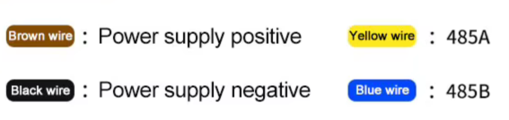

# Informe de verificación de sensores Modbus

Un solo informe que se edita cada vez que se prueba un sensor: qué se compró, si
coincide con su datasheet, qué registros tiene de verdad y cómo se calcula cada
valor.

| Sensor | Marca | Coincide con el datasheet | Estado |
|---|---|---|---|
| [RK330-01](#rk330-01--temperatura-y-humedad) | Rika | Sí, en lo comprado (T y H) | Verificado 2026-11-10 |
| [RK300-08](#rk300-08--multigás) | Rika | **No**: mapa distinto en los 3 documentos | Verificado 2026-11-09, con reclamo pendiente |
| [RK300-02](#rk300-02--polvo-pm10--pm25--pm10) | Rika | Sí, con el orden del ejemplo 7.4; los ejemplos 7.1–7.3 están mal | Verificado 2026-11-10 |
| [RK200-02B](#rk200-02b--radiación) | Rika | Sí, en la medición; el cambio de ID no necesita reinicio aunque el datasheet lo pida | Verificado 2026-11-10 |
| [RS-PM-N01-2 (-T)](#renke-rs-pm-n01-2--polvo-pm25--pm10--pm10) | Renke | Sí, en la medición; el cambio de ID (reg 2000) no está en el manual pero funciona | Verificado 2026-11-10 |
| [RS-GH-N01-AL-T](#renke-rs-gh-n01-al--radiación-par-µmolm²s) | Renke | Sí, en la medición y el cambio de ID | Verificado 2026-11-11 |

## Cómo se prueba y cómo leer las tablas

- **Banco:** ESP32 con el firmware de este repositorio. Lectura cruda con
  `@leer` (`include/flujo.h`) y la interfaz `gui/graficador.py`.
- **Direcciones:** base 0, en decimal y hex: `4 (0x0004)`. Es lo que se escribe
  en el campo de registro, no la notación 40001.
- **Tipos:**
  - **u16:** entero sin signo de 16 bits (0..65535).
  - **s16:** entero con signo en complemento a dos. Si el crudo es ≥ 32768, el
    valor es `crudo − 65536`. Por ejemplo, `0xFE70` = 65136 → −400.
- **Procedimiento por sensor:**
  1. Sondear qué registros responden y hasta dónde.
  2. Provocar cambios (aliento, fósforo, humidificador, luz) con el muestreo grabando.
  3. Comparar con el datasheet.
  4. **Probar el cambio de ID:** cambiarla a 2, comprobar que responde la 2 y no la 1, y
     volver a 1. Se usa la opción "Cambiar ID del sensor" de la consola, con el registro que
     indique el datasheet.
- **Conversión:** `valor = crudo_con_signo × multiplicador + offset`.
- **Cableado Renke:** los colores no son los habituales, porque el amarillo y el azul son el bus,
  no la alimentación.

  

  | Cable | Función |
  |---|---|
  | Marrón | Alimentación + |
  | Negro | Alimentación − (GND) |
  | **Amarillo** | **485-A** |
  | **Azul** | **485-B** |

  Lo confirma el manual del RS-PM-N01-2. **No es igual en todos los Renke:** el manual del
  RS-GH-N01-AL pone el **485-A en el cable verde** (no amarillo), y así viene la unidad. Revisar el cable de cada
  sensor y anotarlo en su sección. Los Rika usan otro código (en el RK300-02: rojo V+,
  negro V−, amarillo A, verde B).
- **Patrón común a los Rika probados:**
  - Los registros 30–32 guardan las **direcciones de los registros de configuración**: RK200-02B
    66 y 64 (dirección y baudrate); RK330-01 128 y 129 (baudrate y paridad); RK300-02 48 en
    adelante (dirección).
  - El registro 13 guarda el baudrate escrito en hex (`0x9600`).
  - Sirve para ubicar el registro de cambio de ID cuando el datasheet no lo dice o se contradice. Es la
  misma fórmula que usa `data/sensores.json` (campos `mult` y `off`).
- **Cómo se sabe cada registro:**
  - **Confirmado con estímulo:** se provocó un cambio (aliento, fósforo,
    humidificador) y el registro respondió como corresponde.
  - **Datasheet + plausible:** el documento lo dice y el valor medido tiene
    sentido, pero no se provocó un cambio.
  - **Deducido:** el documento no lo dice; se dedujo de los valores.
  - **Sin identificar:** responde, pero no se sabe qué es.

---

## RK330-01 — Temperatura y humedad

**Compra:** factura R26101402, ítem 1: RK330-01A, 2 unidades. Se compró solo
**temperatura y humedad**, con escudo de radiación RK95-01. Rango −40–60 ℃ ±0,5 ℃
y 0–100 %RH ±3 %RH.

**Datasheet:** `Datasheets/RK330-01_T,H.pdf` ("Communication Protocol
(MODBUS-RTU)", 2 páginas).

**Unidad probada:** 1 de las 2, el 2026-11-10.

### Comunicación

| Parámetro | Valor | ¿Coincide con el datasheet? |
|---|---|---|
| ID | 1 | Sí |
| Serie | 9600 baud, 8N1 | Sí |
| Lectura | Función 03 (holding) | Sí. La función 04 no responde (no la indica). |
| Escritura | Función 06 | Según el datasheet; no probada. |
| Máximo por lectura | Hasta el registro 32 (0–32 en una trama) | El datasheet no lo indica. Leer 0–33, el 34 solo o bloques más arriba no da respuesta (timeout, no excepción). |
| Actualización | No medida | — |

### Registros

| Reg | Variable | Tipo | Conversión | Unidad | Ejemplo medido | Cómo se sabe |
|---|---|---|---|---|---|---|
| **0 (0x0000)** | **Temperatura** | **s16** | **÷ 10** | ℃ | 283 → **28,3 ℃** | Datasheet + plausible |
| **1 (0x0001)** | **Humedad relativa** | **u16** | **÷ 10** | %RH | 392 → **39,2 %RH** | Datasheet + plausible |
| 2 (0x0002) | Presión | u16 | ÷ 10 | hPa | 0 | Datasheet. Vale 0 porque no se compró. |
| 3 (0x0003) | Punto de rocío | s16 | ÷ 10 | ℃ | 130 → 13,0 ℃ | **Deducido**: el calculado con T y H (Magnus) da 13,1 / 12,9 / 13,0 contra 13,0 / 12,8 / 12,9 medido |
| 12 (0x000C) | Dirección del esclavo (lectura) | u16 | — | — | 1 | Deducido |
| 13 (0x000D) | Baudrate | u16 en hex "BCD" | — | — | `0x9600` = 9600 | Deducido. Usa la misma codificación del datasheet: `0x1200` = 1200, `0x4800` = 4800 |
| 16 / 17 | Rango de temperatura mín./máx. | s16 | ÷ 10 | ℃ | −400 / 600 → −40,0 / 60,0 | Deducido; coincide con la ficha (−40–60 ℃) |
| 18 / 19 | Rango de humedad mín./máx. | u16 | ÷ 10 | %RH | 0 / 1000 → 0 / 100,0 | Deducido |
| 20 / 21 | Rango de presión mín./máx. | u16 | ÷ 10 | hPa | 3000 / 11000 → 300,0 / 1100,0 | Deducido |
| 31 / 32 | ? | u16 | — | — | 128 / 129 | Sin identificar (constantes) |
| 4–11, 14, 15, 22–30 | — | — | — | — | 0 | — |

**Cómo calcular.** Por ejemplo, para una temperatura bajo cero:

- crudo de temperatura `0xFF9C` = 65436 → es s16 y ≥ 32768 → 65436 − 65536 = −100 → −100 ÷ 10 = **−10,0 ℃**
- crudo de humedad `0x0188` = 392 → u16 → 392 ÷ 10 = **39,2 %RH**

### Diferencias y erratas del datasheet

- **Temperatura negativa:** el ejemplo negativo divide por 100 (`−251/100 = −2.51 ℃`) y el
  positivo por 10. Lo correcto es **÷ 10**. Coincide con la resolución de 0,1 ℃ y con los
  registros de rango (−400 = −40,0 ℃).
- **Errata del ejemplo positivo:** escribe `(0121)H=(298)D`, pero 0x0121 = 289; el resultado,
  28,9 ℃, está bien.
- **Presión:** la tabla dice kPa y el ejemplo convierte a mbar (10024 → 1002,4). Por los
  registros de rango (300–1100), la unidad es **hPa (= mbar)**. No aplica a esta unidad
  porque no trae presión.
- **Cambio de ID:** el datasheet escribe la ID nueva con función 06 en el **registro 0**, y su
  respuesta no es el eco estándar de la 06. La opción "Cambiar ID" de ModbusEmpire espera el
  eco, así que marcaría error aunque el cambio haya funcionado. El cambio toma efecto después
  de reiniciar el sensor. **No probado.**
- **Códigos de baudrate:** la tabla de códigos no incluye 9600, aunque el sensor viene a 9600
  y el registro 13 lo informa como `0x9600`.

**Conclusión:** coincide con lo comprado. Temperatura (reg 0, s16 ÷ 10) y humedad (reg 1,
u16 ÷ 10) están donde dice el datasheet. Además trae el punto de rocío en el registro 3, que el
datasheet no menciona.

---

## RK200-02B — Radiación

**Compra:** factura R26101402, ítem 3: RK200-02 (RK200-02B), 2 unidades. Rango espectral
0–2000 W/m², precisión ±5 % de la lectura, respuesta ≤ 1 s.

**Qué es la "B":** según las fichas de Rika, el RK200-02 tiene dos tipos.

- **Tipo A:** PAR real, 400–700 nm, 0–2500 **µmol/m²·s**.
- **Tipo B:** radiación de 350–1100 nm, 0–2000 **W/m²**. Es el comprado.

A pesar del nombre comercial "PAR", el tipo B **no entrega PPFD en µmol/m²·s** sino
irradiancia en W/m².

- Ficha V5.0 (2025): `Datasheets/RK200-02_rika-spec-v5.0_PAR.pdf`
- Ficha V3.0 del B: `Datasheets/RK200-02B_opengrow-spec-v3.0_PAR.pdf`

En el código de pedido V5.0, la segunda letra es la alimentación y la tercera el rango. Una
etiqueta que diga solo "02B" no distingue entre las dos. Si la etiqueta trae el código
completo, el rango W/m² es una B en la tercera posición.

**Datasheet del protocolo:** `Datasheets/RK200-02_PAR.pdf` ("RK200-02 Communication Protocol
(MODBUS-RTU)", 1 página, sin letra de variante). Corresponde al tipo B: da la radiación en
W/m².

**Unidad probada:** 1 de las 2, el 2026-11-10, con la linterna del celular, tapándolo y
apuntándolo a una ventana.

### Comunicación

| Parámetro | Valor | ¿Coincide con el datasheet? |
|---|---|---|
| ID | **9** (de fábrica) | Sí |
| Serie | 9600 baud, 8N1 | Sí |
| Lectura | Función **04** (input). La función 03 devuelve los mismos valores. | Sí: el datasheet indica 04 |
| Máximo por lectura | 0–31 en una trama; 0–63 no responde | El datasheet no lo indica |
| Tiempo por muestra | 109 ms para 32 registros | — |

### Registros

| Reg | Variable | Tipo | Conversión | Unidad | Oscuro → linterna | Cómo se sabe |
|---|---|---|---|---|---|---|
| **0 (0x0000)** | **Radiación** | u16 | × 1 | **W/m²** | 0 → 15 | **Confirmado con estímulo** + datasheet |
| 1 (0x0001) | Copia de la radiación | u16 | × 1 | W/m² | igual al reg 0 en las 300 muestras | Deducido |
| 2 (0x0002) | ? (sigue a la luz) | u16 | — | — | 1 → 22 | **Sin identificar**: sube y baja con la luz, pero no es proporcional al reg 0 (1 en oscuridad; entre 1,25 y 6 veces el reg 0) |
| 12 (0x000C) | ? | u16 | — | — | 9 | Sin identificar. **No es la dirección activa**: siguió en 9 con la ID cambiada a 2 |
| 13 (0x000D) | Baudrate | u16 en hex "BCD" | — | — | `0x9600` | Deducido; igual que en el RK330-01 |
| 20 | Tope del rango | u16 | × 1 | W/m² | 2000 | Deducido; coincide con 0–2000 W/m² |
| 21 / 22 / 25 / 26 / 27 / 28 | ? | — | — | — | 2001 / 150 / 4 / 1 / 1000 / −5 (s16) | Sin identificar (constantes) |
| 30 / 31 | Dirección de los registros de configuración | u16 | — | — | 66 (`0x42`) / 64 (`0x40`) | Deducido: el 66 es el registro de la dirección y el 64 el del baudrate, según el datasheet |

**Cómo calcular:** el valor es el crudo directamente, en W/m². Por ejemplo, el reg 0 = 296 →
**296 W/m²**, que es el ejemplo del datasheet (`09 04 02 01 28 …`).

**Para PPFD:** el sensor no lo entrega. Las fichas dan sensibilidades analógicas de 1000 µV por
W/m² (tipo B) y 800 µV por µmol/m²·s (tipo A), lo que sugiere unos 1,25 µmol/m²·s por W/m².
**No es un dato del protocolo**, y los dos tipos miden bandas espectrales distintas; no usarlo
sin calibrar.

### Cambio de ID

**Probado el 2026-11-10: funciona, con una diferencia respecto del datasheet.**

- **Cómo se hace:** función 06 en el registro **0x0042 (66)** con la ID nueva (0–255).
- **Respuesta:** eco estándar, así que la opción "Cambiar ID" de ModbusEmpire lo da por exitoso.
- **Diferencia con el datasheet:** el documento dice que el cambio se aplica después de
  reiniciar, pero **rige al instante**. Se cambió 9 → 2, respondió la 2 y no la 9, y se volvió
  2 → 9.
- **Reinicio:** no se probó qué ID tiene el sensor al reiniciarlo después de un cambio.
- **Baudrate:** según el datasheet, se cambia con 06 en el registro **0x0040 (64)**, por
  código: 0=1200, 1=2400, 2=4800, 3=9600, 4=19200, 5=38400, 6=57600, 7=115200. No probado.
- **ID olvidada:** el datasheet indica usar la dirección de difusión **0x00**, con el sensor
  solo en el bus. No probado.

**Evidencia:** `informe/capturas/rk200-02b_luz_0-31.csv`: 2,5 min, registros 0–31, cada
500 ms.

- **Linterna:** desde 1:22, hasta 15 W/m².
- **Tapado:** desde 1:34, 0 W/m².
- **Ventana:** cerca de 1:50, 2 W/m² con luz indirecta.

**Conclusión:** coincide con lo comprado (tipo B, en W/m²). La radiación está en el registro 0,
en W/m² sin conversión, con función 04, ID 9 y 9600. Queda sin identificar el registro 2, que
también sigue a la luz. Para ver si es otra magnitud, hay que probarlo con sol directo, que da
cientos de W/m².

---

## RK300-02 — Polvo (PM1.0 / PM2.5 / PM10)

**Compra:** factura R26101402, ítem 2: RK300-02, 2 unidades, con escudo de radiación RK95-01.
Se compró **PM1.0, PM2.5 y PM10**, con rango 0–1000 µg/m³ y precisión ±10 %FS a 25 ℃. La
etiqueta de la unidad dice 300-02B.

**Datasheet:** `Datasheets/RK300-02_PM1,PM2.5,PM10.pdf` ("Dust Concentration Sensor User
Manual" V5.0, rev. 20260112). Lo mandó el proveedor. Medición por dispersión láser,
calentamiento de 3 min, respuesta < 1 s. Cables: rojo V+, negro V−, amarillo A, verde B.

**Unidad probada:** 1 de las 2, el 2026-11-10, con dos fósforos.

### Comunicación

| Parámetro | Valor | ¿Coincide con el datasheet? |
|---|---|---|
| ID | 1 | Sí |
| Serie | 9600 baud, 8N1 | Sí |
| Lectura | Función 03 | Sí. La función 04 no responde. |
| Máximo por lectura | 0–33 en una trama sin problema. Los registros sueltos 33 y 34 responden; el 40 y el 48 no. | El datasheet no lo indica |
| Actualización | **1 vez por segundo** (cambios cada 1000 ms exactos) | El datasheet dice respuesta < 1 s |
| Tiempo por muestra | 110 ms para 32 registros | — |

### Registros

| Reg | Variable | Tipo | Conversión | Unidad | Reposo → con fósforo | Cómo se sabe |
|---|---|---|---|---|---|---|
| **0 (0x0000)** | **PM1.0** | u16 | × 1 | µg/m³ | 1 → 58 | **Confirmado con estímulo** |
| **1 (0x0001)** | **PM2.5** | u16 | × 1 | µg/m³ | 3 → 93 | **Confirmado con estímulo** |
| **2 (0x0002)** | **PM10** | u16 | × 1 | µg/m³ | 3 → 119 | **Confirmado con estímulo** |
| 3 (0x0003) | Copia del PM10 (¿TSP?) | u16 | × 1 | µg/m³ | igual al reg 2 en las 360 muestras | Deducido |
| 4, 5, 7 | ¿Tope de rango? | u16 | — | — | 1000 | Deducido; coincide con el rango 0–1000 µg/m³ |
| 12 / 13 | ? | u16 | — | — | 10 / 30 | Sin identificar (constantes) |
| 14 (0x000E) | ? | u16 | — | — | 1 | Sin identificar. **No es la dirección**: siguió en 1 con la ID cambiada a 2 |
| 15 / 16 / 17 | ¿Número de serie? | u16 | — | — | `0x4567` / `0x8901` / `0x23AB` | Sin identificar (constantes) |
| 19, 21, 34 | ? | u16 | — | — | 1000 | Sin identificar (constantes) |
| 27 / 28 | ? | u16 | — | — | 1 / 2 | Sin identificar (constantes) |
| 30 / 31 / 32 | ? | u16 | — | — | 48 / 49 / 50 (`0x30` / `0x31` / `0x32`) | Sin identificar. El `0x30` es la dirección que el datasheet da para el registro de dirección del esclavo |
| 6, 8–11, 18, 20, 22–26, 29, 33 | — | — | — | — | 0 | — |

**Cómo se identificó:** en las 360 muestras se cumple siempre **reg 0 ≤ reg 1 ≤ reg 2**. Ese
es el orden físico PM1.0 ≤ PM2.5 ≤ PM10, y los tres suben y bajan juntos con el humo.

**Cómo calcular:** el valor es el crudo directamente, en µg/m³. Por ejemplo, el reg 1 = 93 →
**PM2.5 = 93 µg/m³**.

### Diferencias con el datasheet

- **Ejemplos contradictorios:** los ejemplos 7.1 y 7.2 leen el registro 0 y lo llaman PM2.5 y
  PM10; el 7.3 pone PM2.5 en el 0. **El correcto es el 7.4** ("three in one"): PM1.0 en el 0,
  PM2.5 en el 1 y PM10 en el 2.
- **Registros sin documentar:** el datasheet no menciona el registro 3 (copia del PM10) ni los
  registros de configuración y constantes del 4 al 34.
- **Cambio de ID: probado, funciona como dice el datasheet** (2026-11-10).
  - **Cómo se hace:** función 06 en el registro **0x0030 (48)** con la ID nueva, distinto del
    RK300-08, que usa el 15.
  - **Respuesta:** el eco estándar de la función 06, así que la opción "Cambiar ID" de
    ModbusEmpire lo da por exitoso.
  - **Efecto:** el cambio rige **al instante, sin reiniciar**; la ID anterior deja de
    responder.
  - **Prueba:** se cambió 1 → 2, se leyó con la ID 2, se comprobó que la 1 no contestaba y se
    volvió 2 → 1.
  - **Lectura:** el registro 48 no se puede leer, porque no responde.
  - **ID olvidada:** el datasheet indica usar la dirección de difusión `0xFE`, con el sensor
    solo en el bus. No probado.
- **Baudrate y paridad:** el datasheet no trae registros para cambiarlos.

**Evidencia:** `informe/capturas/rk300-02_fosforo_0-31.csv`: 3 min, registros 0–31, cada
500 ms, con dos fósforos. El primero se ve en ~0:20–1:10 y el segundo en ~1:39–2:00.

**Conclusión:** coincide con lo comprado. PM1.0, PM2.5 y PM10 están en los registros 0, 1 y 2,
en µg/m³ sin conversión, como dice el ejemplo 7.4 del datasheet.

---

## RK300-08 — Multigás

**Compra:** factura R26101402, ítem 4: RK300-08, 1 unidad, con escudo de radiación. Se
compró con **CO₂** (0–5000 ppm), **SO₂** (0–10 ppm, resolución 0,001), **O₂**
(0–30 %VOL, resolución 0,1) y **PM1.0/2.5/10** (0–1000 µg/m³).

**Datasheets:** ninguno corresponde a la unidad.

- `Datasheets/RK300-08_CO2,SO2,O2,PM1,PM2.5,PM10.pdf`: lo mandó el proveedor.
- `Datasheets/RK300-08_proveedor-2_CO2,SO2,O2,PM1,PM2.5,PM10.pdf`: lo mandó el proveedor;
  es el mismo mapa con registros de configuración 40–42.
- `Datasheets/RK300-08_manual-v5.0-oficial_….pdf`: sitio de Rika, mismo mapa.
- `Datasheets/RK300-08_spec-v5.2-2025_….pdf`: ficha nueva, modular, sin tabla de registros.

Los tres mapas ponen PM2.5 en 0, CO₂ en 6, O₂ en 7, SO₂ en 8 y PM1.0 en 18. La unidad no
responde así. Solo coincide la dirección del esclavo en el registro 15.

**Unidad probada:** el 2026-11-09, con pruebas de aliento, fósforos y humidificador
ultrasónico.

### Comunicación

| Parámetro | Valor | ¿Coincide con el datasheet? |
|---|---|---|
| ID | 1 | Sí |
| Serie | 9600 baud, 8N1 | Sí |
| Lectura | Función 03 | Sí. La función 04 no responde. |
| Máximo por lectura | 64 registros sin problema (0–63 y 64–124 leídos) | El datasheet no lo indica |
| Actualización | **1 vez por segundo** en todas las variables (cambios cada 1000 ms exactos) | El datasheet no lo indica |
| Tiempo por muestra | 76 ms para 20 registros (55 ms de cable + ~21 ms de respuesta) | — |

### Registros

| Reg | Variable | Tipo | Conversión | Unidad | Reposo | Cómo se sabe |
|---|---|---|---|---|---|---|
| **4 (0x0004)** | **CO₂** | u16 | × 1 | ppm | 406–466 | **Confirmado con estímulo**: aliento → 3256; fósforos → 2315 |
| **8 (0x0008)** | **PM2.5** | u16 | × 1 | µg/m³ | 3 | **Confirmado con estímulo**: humo → 1003 |
| **9 (0x0009)** | **PM10** | u16 | × 1 | µg/m³ | 3 | **Confirmado con estímulo**: humo → 1913 |
| **10 (0x000A)** | **PM1.0** | u16 | × 1 | µg/m³ | 1 | **Confirmado con estímulo**: humo → 586 |
| **19 (0x0013)** | **O₂** | u16 | × 0,1 | %VOL | 208 → 20,8 % | **Confirmado con estímulo**: aliento → 19,4 % |
| 0 (0x0000) | ¿SO₂? | u16 | × 0,01 (supuesto) | ppm | 2 → 0,02 | **Sin identificar**: subió a 40 una vez con aliento; no reacciona a fósforos ni a humidificador |
| 15 (0x000F) | Dirección del esclavo | u16 | — | — | 1 | Datasheet (escritura con 06) + plausible |
| 16 (0x0010) | Baudrate (literal) | u16 | — | baud | 9600 | Deducido. El datasheet dice CH₄ |
| 30 | ? | u16 | — | — | 769 (`0x0301`) | Sin identificar (constante; ¿versión 3.1?) |
| 32 / 33 | ? | u16 | — | — | 16384 / 14916, luego 8960 / 4868 | Sin identificar: cambiaron entre dos lecturas separadas por minutos y quedaron fijos durante 7 min (¿calibración o contador interno?) |
| 14, 17, 18, 20–29 | — | — | — | — | 65535 (`0xFFFF`) | Probablemente "módulo no instalado"; el datasheet no lo explica |
| 1–3, 5–7, 11–13, 31, 34–124 | — | — | — | — | 0 siempre | — |

**Cómo calcular:**

- CO₂: crudo 412 → **412 ppm**
- O₂: crudo 208 → 208 × 0,1 = **20,8 %VOL**
- PM2.5: crudo 3 → **3 µg/m³**

### Lo que no coincide con la compra (para el reclamo)

1. **SO₂:** está en la factura, pero ningún registro responde a SO₂. Tres fósforos encendidos
   juntos al sensor subieron CO₂ y PM, y nada más. El registro 0 es el único candidato y no
   reaccionó.
2. **Humedad:** el proveedor dice que la unidad la tiene, pero ningún registro del 0 al 124
   se comporta como humedad. Una humedad tendría que subir con el aliento y bajar con la llama;
   ningún registro lo hace. Con el humidificador ultrasónico solo subieron los PM.
3. **Mapa de registros:** los tres documentos entregados describen un mapa genérico de 29
   variables que no corresponde a esta unidad. Hay que pedir el mapa de esta versión, dónde va
   el SO₂ y qué significa `0xFFFF`.

### Observaciones de uso

- **PM2.5 se satura cerca de 1000 µg/m³**, que es el tope del rango de compra. Sobre eso el
  valor no es confiable.
- **El agua cuenta como PM:** con el humidificador ultrasónico, PM10 llegó a 1914 µg/m³ por
  las gotitas. En terreno, la niebla o el rocío darán PM altos falsos.
- **Muestrear a más de 1 Hz solo repite valores.**
- **Reinicio espontáneo:** se vio una vez. Tras el reinicio los valores parten de 0 y el CO₂ y
  los PM suben en escalones; el O₂ da un primer valor absurdo, de unos 55000. En los 10 minutos
  de registro posteriores no se repitió (1208 muestras, 0 errores).

**Evidencia:**

- `informe/capturas/rk300-08_reposo_10min.csv`: 10 min, registros 0–19, cada 500 ms. Al
  final, tres fósforos.
- `informe/capturas/rk300-08_humedad_0-34.csv`: 7 min, registros 0–34, con aliento,
  fósforo y humidificador.
  - **Reloj:** el tiempo de la prueba (el que vio el operador) está corrido unos 2 min respecto
    al del registro.
  - **Humidificador:** en el tiempo de la prueba, de 2:20 a 4:20; en el registro, de ~4:30 a
    6:35.

**Conclusión:** de lo comprado, la unidad mide CO₂, O₂ y PM1.0/2.5/10, en registros distintos
a los del datasheet. **El SO₂ no aparece.** Queda en `sensores.json` con el mapa medido, y el
SO₂ en el registro 0 sin confirmar.

---

## Renke RS-PM-N01-2 — Polvo (PM2.5 / PM10 / PM1.0)

**Compra:** modelo según el vendedor "RS-PM-*-2-T". Se esperaba PM2.5 y PM10; también entrega
PM1.0.

**Datasheet:** `Datasheets/RS-PM-N01-2_renke-cn-manual-V2.2_PM2.5,PM10,PM1.pdf`. Es el manual
oficial de Renke, en chino, V2.2, versión 485; lo bajó el agente desde el CDN de Renke.

- **Código del modelo:** RS = Renke, PM = calidad del aire, N01 = salida RS485, 2 = carcasa de
  pared.
- **"-T":** no aparece en ningún documento. Es un sufijo del sitio en inglés que Renke agrega a
  muchos modelos.
- **Variante con temperatura y humedad:** se llama **RS-PMWS-**, con otro mapa (humedad en el
  0, temperatura en el 1, PM desde el 2). **Esta unidad es la variante PM sola.**
- **Cableado (confirmado en esta unidad):** marrón V+ (10–30 V), negro GND, **amarillo 485-A**
  y **azul 485-B**. Ver la imagen en "Cableado Renke", más arriba.
- **Del manual:** precalentamiento ≤ 2 min; rango 0–1000 µg/m³.

**Unidad probada:** el 2026-11-10, con un fósforo.

### Comunicación

| Parámetro | Valor | ¿Coincide con el manual? |
|---|---|---|
| ID | 1 | Sí |
| Serie | **4800 baud**, 8N1 | Sí. **Ojo: los Rika van a 9600.** |
| Lectura | Función 03; la 04 devuelve lo mismo | Sí. La tabla admite 03 y 04, aunque el texto dice "solo 03". |
| Máximo por lectura | 0–63 en una trama sin problema | El manual no lo indica |
| Actualización | 1 vez por segundo | El manual pide un intervalo de sondeo ≥ 200 ms |
| Respuesta al humo | Sube en ~4 s y llega al máximo en ~12 s | El manual dice ≤ 90 s |

### Registros

| Reg | Variable | Tipo | Conversión | Unidad | Reposo → fósforo | Cómo se sabe |
|---|---|---|---|---|---|---|
| **0 (0x0000)** | **PM2.5** | u16 | × 1 | µg/m³ | 5 → 845 | **Confirmado con estímulo** + manual |
| **1 (0x0001)** | **PM10** | u16 | × 1 | µg/m³ | 6–16 → 1435 | **Confirmado con estímulo** + manual |
| **2 (0x0002)** | **PM1.0** | u16 | × 1 | µg/m³ | 0–4 → 284 | **Confirmado con estímulo** + manual |
| 9 (0x0009) | ? | u16 | — | — | 7686 (`0x1E06`) | Sin identificar (constante) |
| 82 / 83 / 84 | Calibración PM10 / PM2.5 / PM1.0 | u16 | ÷ 10 | µg/m³ | 0 / 0 / 0 | Manual (R/W con 06/10). **No tocar.** |
| 256–257 (0x100) | ? | — | — | — | `0x3F99 0x999A` (como float ABCD = 1,2) | Sin identificar (¿factor de calibración?) |
| **2000 (0x07D0)** | **Dirección del esclavo** | u16 | — | — | 1 | **Probado**: se cambió a 2 y la lectura lo reflejó. El manual no lo trae. |
| 2001 (0x07D1) | Baudrate (código) | u16 | — | — | 1 = 4800 | Deducido, por el esquema habitual de Renke (0 = 2400, 1 = 4800, 2 = 9600). No probado. |

**Cómo se identificó:** en las 600 muestras se cumple siempre **PM1.0 ≤ PM2.5 ≤ PM10**, y los
tres suben y bajan juntos con el humo.

**Cómo calcular:** el valor es el crudo directamente, en µg/m³. Por ejemplo, el reg 0 = 85 →
**PM2.5 = 85 µg/m³**.

### Cambio de ID

**Probado el 2026-11-10: funciona, aunque el manual no lo documenta.**

- **Cómo se hace:** función 06 en el registro **2000 (0x07D0)** con la ID nueva.
- **Respuesta:** eco estándar.
- **Efecto:** rige al instante, sin reiniciar.
- **Prueba:** se cambió 1 → 2, se comprobó que respondía la 2 (con el registro 2000 = 2) y no la
  1, y se volvió 2 → 1.
- **Según el manual,** la dirección y el baudrate se cambian con el software "485参数配置软件"
  de Renke.

### Observaciones

- **PM10 en niveles bajos:** con concentraciones bajas, el PM10 salta entre PM2.5 + 1 y
  PM2.5 + 10. Con humo, la diferencia es real y variable. A niveles de aire limpio, el PM10 de
  este sensor no aporta más que el PM2.5.
- **Satura sobre el rango:** PM10 llegó a 1435 µg/m³, por sobre el rango de 1000 del manual.
- **Erratas del manual:** en los ejemplos de PM, el conteo de bytes dice 0x04 cuando son 6 bytes
  (0x06); y dos conversiones están mal escritas (0x52 = 82, no 80; 0x4A = 74, no "009CH").

**Evidencia:**

- `informe/capturas/renke-rs-pm_fosforo_0-15.csv`: 3 min en reposo, registros 0–15.
- `informe/capturas/renke-rs-pm_fosforo_0-2.csv`: 5 min, registros 0–2, fósforo en ~0:20.

**Conclusión:** coincide con el manual. PM2.5, PM10 y PM1.0 están en los registros 0, 1 y 2, en
µg/m³ sin conversión, con ID 1 y **4800 baud**. Sí entrega PM1.0. Configurar el maestro a 4800,
no a 9600 como los Rika.

---

## Renke RS-GH-N01-AL — Radiación PAR (µmol/m²·s)

**Compra:** modelo RS-GH-N01-AL-T (el modelo es seguro).

**Datasheet:** `Datasheets/RS-GH-N01-AL_robu-V1.0_PAR.pdf`. Es el "RS-GH-N01-AL Photosynthetically
active radiation sensor User Manual, Type 485", V1.0, de Renke, publicado por el distribuidor Robu.
En el sitio de Renke no hay PDF.

- **Código del modelo:** GH = radiación fotosintéticamente activa, N01 = salida RS485,
  AL = carcasa de aluminio. El "-T" no aparece en ningún documento.
- **Especificaciones del manual:**
  - rango 0–2500 **µmol/m²·s**, resolución 1, banda 400–700 nm;
  - precisión ±2 % a 1000 µmol/m²·s;
  - respuesta 0,1 s;
  - IP67, cable de 70 cm.
- **Cables (confirmados en esta unidad, coinciden con el manual):** marrón V+ (7–30 V), negro GND,
  **verde 485-A**, azul 485-B. **Distinto del RS-PM**, que usa amarillo para el A.
- **A diferencia del RK200-02B de Rika,** este sí es PAR real, en µmol/m²·s.

**Unidad probada:** el 2026-11-11, con la linterna del celular, tapándolo y con luz de la ventana.

### Comunicación

| Parámetro | Valor | ¿Coincide con el manual? |
|---|---|---|
| ID | 1 | Sí |
| Serie | **4800 baud**, 8N1 | Sí |
| Lectura | Función 03; la 04 devuelve lo mismo | El texto dice "solo 03"; los ejemplos dicen 03/04 |
| Máximo por lectura | 0–63 en una trama sin problema | El manual no lo indica |

### Registros

| Reg | Variable | Tipo | Conversión | Unidad | Medido | Cómo se sabe |
|---|---|---|---|---|---|---|
| **0 (0x0000)** | **Radiación PAR** | u16 | × 1 | **µmol/m²·s** | 0 a oscuras; 20–32 con la ventana; hasta **2500** con la linterna | **Confirmado con estímulo** + manual |
| 3 (0x0003) | ? | u16 | — | — | 0 a oscuras; con luz salta sin orden (168 a 64758) | **Sin identificar**: no está en el manual y no es proporcional al reg 0. **No usar.** |
| 9 (0x0009) | ? | u16 | — | — | 259 (`0x0103`) | Sin identificar (constante; ¿versión 1.03?) |
| 82 (0x0052) | Desvío de calibración | s16 | × 1 | µmol/m²·s | 0 | Manual (R/W). **No tocar.** |
| **2000 (0x07D0)** | **Dirección del esclavo** | u16 | — | — | 1 | Manual + **probado** |
| 2001 (0x07D1) | Baudrate (código) | u16 | — | — | 1 = 4800 | Manual: 0 = 2400, 1 = 4800, 2 = 9600. No probado. |

**Cómo calcular:** el valor es el crudo directamente, en µmol/m²·s. Por ejemplo, el reg 0 = 100 →
**PAR = 100 µmol/m²·s**.

### Cambio de ID

**Probado el 2026-11-11: funciona como dice el manual.**

- **Cómo se hace:** función 06 en el registro **2000 (0x07D0)**, igual que el RS-PM.
- **Respuesta:** eco estándar.
- **Efecto:** rige al instante.
- **Prueba:** se cambió 1 → 2, se comprobó que respondía la 2 (con el registro 2000 = 2) y no la
  1, y se volvió 2 → 1.
- **ID y baudrate desconocidos:** el manual indica consultarlos con la dirección `0xFF`
  (`FF 03 07 D0 00 02`). No probado.

### Observaciones

- **Satura en 2500 µmol/m²·s,** el tope del rango, con la linterna del celular muy cerca.
- **Lee 0 con la luz interior de la pieza** y 20–32 apuntado a la ventana con luz indirecta. El
  manual pide revisar que se haya sacado la tapa protectora si lee 0 con luz.
- **Erratas del manual:**
  - dos CRC de ejemplo mal impresos (`9B AF` → `B9 AF`; `91 59` → `D1 58`);
  - la respuesta de la consulta de dirección y baudrate no cuadra con los 2 registros pedidos;
  - el ejemplo 4.4.1 se titula "temperature and humidity".

**Evidencia:** `informe/capturas/renke-rs-gh_luz_0-15.csv`: 2,5 min, registros 0–15.

- **Linterna:** de ~0:18 a 0:26 y de ~1:58 a 2:16.
- **Ventana:** de ~0:48 a 0:56.

**Conclusión:** coincide con el manual. La PAR está en el registro 0, en µmol/m²·s sin conversión,
con ID 1 y **4800 baud**. El cambio de ID funciona en el registro 2000.
